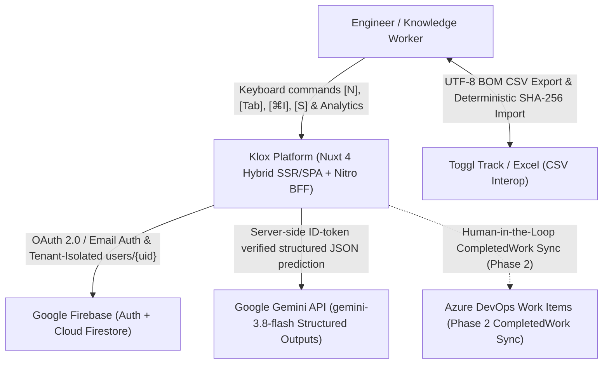
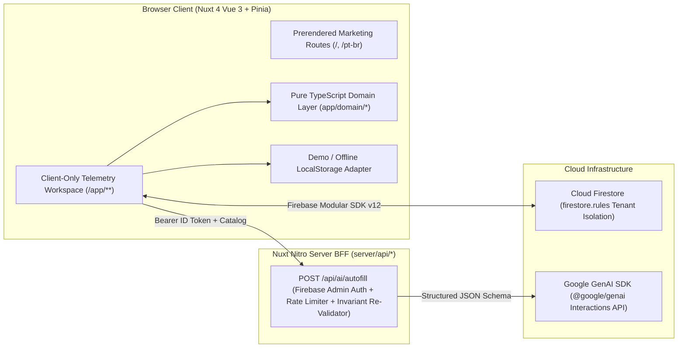

# Klox (`klox.dev`) — AI-Native Time & Execution Telemetry Platform

> **Capstone Project — Post-Graduation in Software and Solutions Architecture with Artificial Intelligence (`XP Educação`)**
> **Author:** Gustavo Oliviera

**Klox (`https://klox.dev`)** is an ultra-fast, keyboard-first, AI-augmented Time Tracking & Execution Management platform engineered with strict Domain-Driven Design (DDD) invariants, a two-tier hybrid AI recall engine (`Fuse.js` + `@google/genai` Structured Outputs), multi-dimensional telemetry analytics, and idempotent bi-directional Toggl Track CSV compatibility.

---

## 1. Architectural Vision & C4 Diagrams

### 1.1 C4 Level 1 — System Context Diagram



### 1.2 C4 Level 2 — Container & Hexagonal Domain Architecture



---

## 2. Domain-Driven Design (DDD) Ubiquitous Language & Invariants

All core domain rules live in pure TypeScript under [`app/domain/`](./app/domain) with zero framework or database imports:

1. **`Project` (`app/domain/types.ts`):** Macro execution context (`id`, `userId`, `name`, `color`, `isBillableDefault`, `systemKey?: 'unassigned'`).
2. **`ProjectTag` (`app/domain/invariants.ts`):** Cross-cutting label **strictly owned by a `Project`** (`projectId`).
   - **Domain Invariant:** Selecting or switching a Project immediately filters selectable tags to `tag.projectId === project.id`, strips incompatible tags (`applyProjectSwitch`), and resets `isBillable` to `project.isBillableDefault`.
3. **`Task` (`app/domain/types.ts`):** Actionable unit of work or personal goal belonging to a `Project`, carrying Phase 2 seams for personal mastery (`targetHours`) and **Azure DevOps Work Item** synchronization (`externalProvider: 'azure_devops'`, `externalWorkItemId`, `completedWorkHours`).
4. **`ActiveTimer` (`app/domain/duration.ts`):** Singleton live-ticking stopwatch state persisted in both Firestore (`users/{uid}.activeTimer`) and `localStorage`.
   - **Resilience Invariant:** Elapsed seconds are always computed via `Math.floor((Date.now() - Date.parse(startTimeUTC)) / 1000)` (`elapsedSeconds`), never via naive `elapsed++` counters, making the timer immune to page refreshes, tab throttling, or browser restarts.
5. **`TimeLog` (`app/domain/types.ts`):** Immutable historical record with denormalized visual snapshots (`projectNameSnapshot`, `projectColorSnapshot`, `tagNamesSnapshot`), IANA `timeZone` snapshot at write time, and `dateKey` (`YYYY-MM-DD`) computed in the user's preferred IANA timezone (`toDateKey`).
6. **`DomainEvent` (`app/domain/events.ts`):** Lightweight typed pub/sub bus (`TimerStarted`, `TimerStopped`, `TimeLogCreated`, `RecallTemplateSelected`, `AiAutofillUsed`, `DashboardViewed`, `CsvImported`, `CsvExported`) decoupling stores from onboarding checklist progression and future Azure DevOps sync triggers.

---

## 3. Two-Tier Hybrid AI Recall & Auto-Fill Engine

| Tier | Engine | Latency | Mechanism |
|---|---|---|---|
| **Tier 1 — Lexical Recall** | `Fuse.js` (`app/domain/recall.ts`) | `< 2 ms` | Deduplicates historical `TimeLog`s by `normalizedDescription + projectId`, ranks by fuzzy similarity + log frequency + recency, and surfaces the **Top 10 templates** in an instant keyboard dropdown. |
| **Tier 2 — Semantic AI Auto-Fill** | `@google/genai` (`server/api/ai/autofill.post.ts`) | `~400–800 ms` | Triggered via `⌘I` / `Ctrl+I`. Verifies Firebase ID token, enforces per-user rate limiting, calls `gemini-3.8-flash` (`client.interactions.create` with Structured JSON `response_format`), and **re-validates on the server** (`validateAiPrediction`) that returned `tagIds` belong to the predicted `projectId`. |

---

## 4. Architecture Decision Records (ADRs)

All architectural decisions are documented in [`docs/adr/`](./docs/adr/README.md):

- **[ADR-0001](./docs/adr/0001-nuxt4-hybrid-rendering-and-bff.md):** Nuxt 4 Hybrid Rendering & Nitro BFF on Firebase App Hosting
- **[ADR-0002](./docs/adr/0002-firebase-tenant-isolation-and-demo-mode.md):** Firebase Tenant Isolation (`users/{uid}`) & Local Demo Mode Fallback
- **[ADR-0003](./docs/adr/0003-entity-id-strategy-firestore-vs-uuidv7.md):** Entity ID Strategy — Firestore Random IDs & Deterministic SHA-256 Import Hashes vs. UUIDv7
- **[ADR-0004](./docs/adr/0004-secured-gemini-autofill-with-domain-validation.md):** Secured AI Auto-Fill with Server-Side Domain Validation
- **[ADR-0005](./docs/adr/0005-i18n-and-user-timezone-semantics.md):** Internationalization (`en`, `pt-BR`) & User-Preferred IANA Timezone Semantics
- **[ADR-0006](./docs/adr/0006-lean-poc-verification-and-pragmatism.md):** Lean POC Verification & Pragmatism (`nuxt typecheck` + Focused Domain Unit Tests)

---

## 5. Local Development & Verification

```bash
# 1. Install dependencies
pnpm install

# 2. Copy environment variables (optional — omit Firebase vars to run in Local Demo Mode)
cp .env.example .env

# 3. Start development server at http://localhost:3000
pnpm dev

# 4. Run strict TypeScript check & pure domain unit tests
pnpm typecheck
pnpm test

# 5. Build production hybrid bundle (prerenders / and /pt-br, builds Nitro server)
pnpm build
```